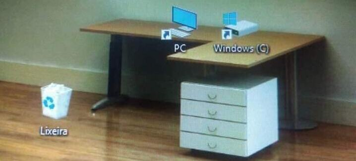

<h1 align="center">Hi, I'm Charnchon 👋</h1>

  <b>Full Stack Developer · AI adoption at Atiom (Thailand)</b> 
  5+ years building web platforms end to end. These days I help teams turn AI into something people actually use every day.

  
  
  
  

---

### 🚀 What I'm working on

- 🤖 Built an **MCP server** (TypeScript, Express, AWS Fargate) so AI clients like Claude can create and edit training content directly in our Hub editor
- 🧠 Designing an **in-product AI assistant** that takes repetitive admin work (tagging content, assigning roles) off people's plates
- 🎮 Making **[Shattered Realm](https://charnchon.github.io/shattered-realm/)**, a wave-survival browser game in TypeScript, on the side

### 🧰 Toolbox

**Languages** 

**Frontend** 

**Backend & data** 

**Cloud & tools** 

### 📌 Featured projects

| Project | What it is | Stack |
| --- | --- | --- |
| [**Shattered Realm**](https://github.com/Charnchon/shattered-realm) · [▶ play](https://charnchon.github.io/shattered-realm/) | Wave-survival action game: 4 classes, 16 cards each, 12 waves, 4 bosses, headless smoke tests | TypeScript, Canvas, esbuild |
| [**resume-website**](https://github.com/Charnchon/resume-website) · [↗ live](https://charnchon.github.io/resume-website/) | My personal resume site | HTML, CSS |
| [**next-setup-project**](https://github.com/Charnchon/next-setup-project) | Next.js starter setup | TypeScript, Next.js |
| [**nuxt-setup-project**](https://github.com/Charnchon/nuxt-setup-project) | Nuxt base setup with Vuetify + Tailwind | TypeScript, Nuxt |

### 💼 Where I've been

- **Atiom (Thailand)**, Full Stack Developer · 2025 – now
- **VGI Digital Lab (BSS Holdings)**, Full Stack Developer · 2023 – 2025
- **ZOindy (Thai Group Holdings)**, Software Developer · 2024
- **AppMan**, Software Engineer · 2022 – 2023
- **Artisan Digital Asia**, Software Developer · 2021 – 2022
- 🎓 **Chiang Mai University**, B.Sc. Digital Industry Integration, first-class honors

🥹 Bonus: my best PC ever

 

